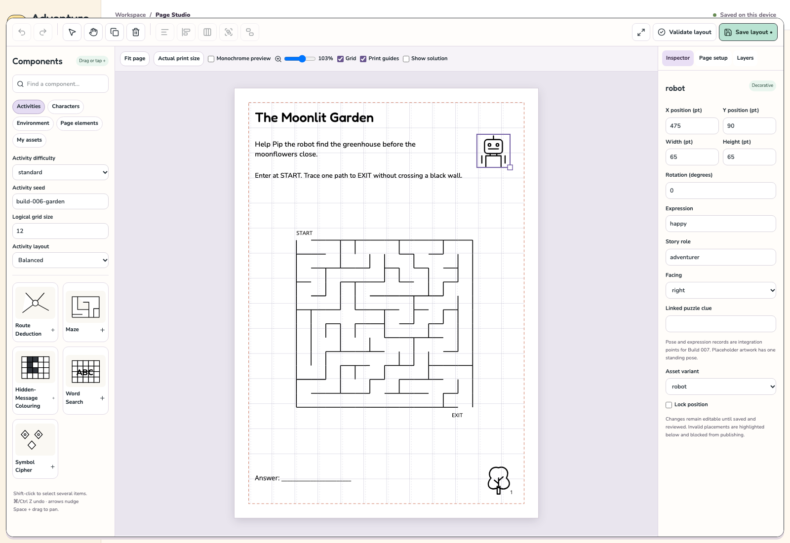

# Build 006 — Visual Page Studio & Interface Redesign

Implemented a visual, monochrome page-production editor alongside the existing five puzzle engines, local persistence, batch queue, approval workflow and exports. The saved Build 006 brief is docs/BUILD-006-BRIEF.md.

## Delivered
- Original cream/mint/lavender/pink design, rounded Fredoka/Nunito typography with bundled OFL licences, Lucide controls, clear keyboard focus, responsive desktop/tablet shell and expanded canvas mode.
- Searchable component categories with previews: five activities, six character placeholders, buildings/trees/bridges/rivers/mountains/doors/windows/clouds, text/page elements and frames.
- Drag/drop or tap-to-add; selection, pointer movement/resizing, exact geometry, decorative rotation, duplication/deletion, basic alignment/distribution, grouping, layer order/visibility/locks, zoom/pan/fit and shortcuts.
- Independent six/12/custom/free layout grids, snap toggles, print guides and monochrome preview. No editor chrome enters print output.
- Letter/A4/A5/square/pocket/custom page settings, orientation, trim/bleed/margins/inset/gutter/DPI, proportional repositioning and unsafe-layout warnings.
- Contextual activity, text, scenery and character properties. Whole activity blocks retain authoritative puzzle references and independent solution validation. Activity changes preserve unrelated components.
- Reusable device-local asset import, metadata/tags/category/favourites/versioning, explicit rights notes/approval and reuse. SVG validation and hash checks run again during server export. Raster files become monochrome icon masks.
- Versioned optional editor layouts, bounded undo/redo, per-project/page draft recovery, project JSON persistence, and legacy compatibility. Existing approved legacy pages remain unchanged unless explicitly reopened/migrated.
- A shared SVG renderer for canvas/PDF/PNG/source exports; saved visual print settings and fixed-weight embedded print fonts; PNG DPI metadata; source/answer/provenance/manifests and current approval gates.

## Verification
40 unit/integration tests, strict type checks, production build and eleven local browser workflows passed. The complete visual workflow includes a blank A4 page, dragged maze, scenery/text, resize handle, undo/redo, save, reload, validation, approval and a real mixed-page PDF/PNG package download. Device-local asset reuse and keyboard/draft recovery are tested.

Actual A4 player/answer PDFs were rendered, not merely inspected as SVGs. All three fonts embed, dimensions are correct, and all text/drawing bounds fit. See artifacts/build-006/pdf-verification.json. Desktop/tablet screenshots show no browser errors or page overflow.

Live staging: https://adventure-studio-staging.garetha81.workers.dev

Release commit: 3f3b16c — `feat: build visual Page Studio and playful UI` — pushed to origin/main.

Final source commit: 4f00a20 — shared browser/Worker export pipeline — pushed to origin/main.

Final deployment: 56b622ed-9775-4ba0-884b-d9c8c89acfbd.

All eleven live workflows pass on the final deployment, including the forced-capacity browser rendering path and validation-gate protection. Freshly generated live A4 player/answer PDFs embed all three fonts and pass dimension/text/path bounds checks. Deployed desktop/focus/tablet screenshots are captured below. Worker resource limits recurred under overlapping export workloads; retry alone was insufficient. The final shared pipeline has a browser adapter that completes the same validated package without depending on Worker rendering capacity. The short heap capture had no useful allocation samples, so no CPU/memory root cause is claimed. Direct API clients remain subject to Worker capacity; the studio automatically uses browser rendering if needed. The client retries transient network/5xx failures once, then renders locally using the identical validation and composition pipeline. Approval/validation errors are never retried. No paid resource-limit increase was made.

## Screenshots

[Dashboard](../screenshots/build-006-dashboard.png) · [Full Page Studio](../screenshots/build-006-page-studio.png) · [Tablet](../screenshots/build-006-tablet.png)

## Review assets
artifacts/build-006 includes an editable A4 Moonlit Garden composition, player/answer PDFs, 300 DPI preview, original SVGs, project JSON, provenance, manifest, validation report and complete ZIP. Its robot/tree are original placeholders; it is a review copy, not an owner-approved publication.

## Boundaries and remaining limitations
Full modular character creation remains Build 007. Detailed world/scene authoring remains Build 008. Functional puzzle paths/clues remain protected inside one block. Grouping/basic alignment are intentionally simpler than a full desktop publishing package. SVG import uses a strict safe subset; raster thresholding is for simple icons. Storage remains browser-local with ordinary quotas; no shared persistence migration, paid AI request or unrelated resource/DNS change occurred. See docs/KNOWN-LIMITATIONS.md for the complete current limits.

The shared export pipeline now accepts either the Node/Worker PDFKit engine or the lazy-loaded browser PDFKit engine. After transient retries, Worker/network capacity failures use local rendering with identical schema, puzzle, layout, provenance and approval validation. A forced-503 browser test verifies the three-font A4 package; a forced-400 test verifies that validation errors cannot invoke fallback. Real browser-generated PDFs also passed dimension, embedded-font and bounds inspection.

Final live print proof: A4 PDFs embed Fredoka Medium, Nunito Medium and Open Sans; all text and paths fit. The live browser-rendered PNG is 2480×3508 pixels at 300 DPI. Source SVG contains neither UI colours nor editor overlays. Evidence: artifacts/build-006/live-verification.json.
